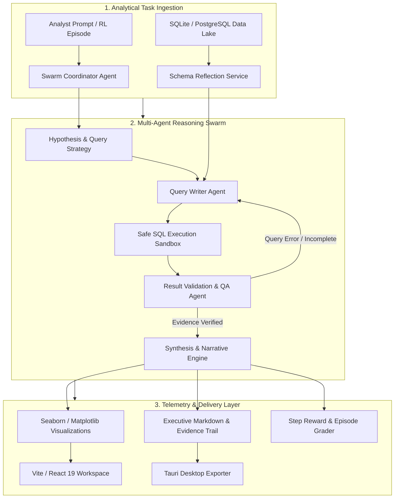
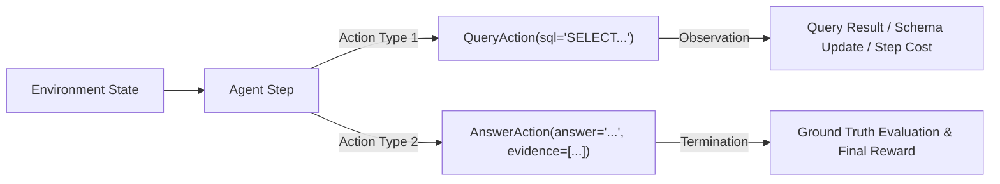

# SwarmAnalyst: Multi-Agent SQL Data Investigation & Analytics Environment

[](https://opensource.org/licenses/MIT)
[](https://huggingface.co/spaces/Markmayandi/sql_data_analyst)
[](https://www.python.org/)
[](https://fastapi.tiangolo.com/)
[](https://react.dev/)
[](https://tauri.app/)
[](https://www.rust-lang.org/)

> **A multi-agent data investigation platform and Gym-compatible reinforcement learning environment where autonomous AI agents analyze relational databases via iterative SQL formulation, hypothesis testing, and verifiable evidence generation.**

| Service | Environment | Live URL | Status |
| :--- | :--- | :--- | :--- |
| **Interactive Web Application** | Hugging Face Spaces | [huggingface.co/spaces/Markmayandi/sql_data_analyst](https://huggingface.co/spaces/Markmayandi/sql_data_analyst) |  |
| **Investigation Backend Engine** | FastAPI / Docker | Local Port 8000 |  |
| **Native Desktop App (MSI / EXE)** | Tauri / PyInstaller Sidecar | Windows x64 Native Bundle |  |

---

## Executive Summary

**SwarmAnalyst** is an autonomous multi-agent data analytics and hypothesis-testing environment designed to replicate the end-to-end cognitive workflow of senior business intelligence engineers. While standard text-to-SQL benchmarks evaluate single-turn query synthesis, real-world data investigations require an agent to iteratively formulate hypotheses, inspect evolving schemas, isolate statistical anomalies, compute correlation metrics across joins, and synthesize verifiable analytical narratives backed by concrete numeric evidence.

SwarmAnalyst provides a dual-interface architecture:
1. **Gym-Compatible OpenEnv Environment:** Evaluates autonomous agents against multi-step investigation benchmarks with structured observation spaces and shaped reward surfaces.
2. **Enterprise Desktop & Web Application:** Combines a reactive TypeScript frontend, live WebSocket agent telemetry, high-density Seaborn dashboard generation, and a zero-dependency Tauri desktop client.

---

## The Core Challenge: Single-Turn SQL vs. Iterative Investigation

```
   TRADITIONAL TEXT-TO-SQL:
   User Prompt  -----> [ LLM Single Shot ] -----> Generated SQL -----> Result Table
   (Fails on ambiguity, multi-table drill-downs, root cause diagnosis, and schema subtleties)

   SWARMANALYST MULTI-STEP REASONING LOOP:
   Initial Task -----> Hypothesize -----> Query Schema -----> Execute Drill-Down
                           ^                                          |
                           |-------- Audit Result & Refine <----------|
                           |
                           v
                     Synthesize Finding & Ground-Truth Verification
```

### Key Industry Bottlenecks

1. **Hallucinated Aggregations and Schema Blindness:**
   - Single-shot models frequently invent non-existent column names, fail on compound foreign key joins, and misunderstand business-specific categorical codings.
2. **Absence of Diagnostic Depth:**
   - Business queries like *"Why did revenue drop in Q3?"* cannot be answered with one SQL query. They require multi-dimensional decomposition across product categories, geographic tiers, supplier lead times, and customer return rates.
3. **Lack of Evidence Auditing:**
   - Unchecked generative outputs produce unsupported claims without citing the exact query outputs or metric calculations that validate their statements.

---

## System Architecture

SwarmAnalyst is structured into an iterative, multi-role agent collaboration engine:



---

## Reinforcement Learning Environment (OpenEnv)

SwarmAnalyst implements a strict dual action space designed for reinforcement learning agents:



### Action Space Specification

- **`QueryAction(sql: str)`**: Submits an exploratory SQL query to the database sandbox. Returns table records, column names, execution duration, and schema updates.
- **`AnswerAction(answer: str, evidence: list[str])`**: Submits the final diagnostic narrative alongside specific statistical proofs to conclude the episode.

### Multi-Dimensional Reward Formulation

The environment provides dense intermediate reward shaping to accelerate policy convergence:

$$\mathcal{R}_{\text{step}} = r_{\text{info}} - c_{\text{error}} - c_{\text{duplicate}}$$

- **Information Gain ($r_{\text{info}}$):** $+0.0 \to +0.2$ awarded for probing previously unvisited schema entities and producing productive row outputs.
- **Syntax Penalty ($c_{\text{error}}$):** $-0.05$ assessed for invalid SQL statements or schema exceptions.
- **Redundancy Penalty ($c_{\text{duplicate}}$):** $-0.10$ penalized for repeating previously submitted queries.

The terminal episode reward $\mathcal{R}_{\text{final}} \in [0.0, 1.0]$ evaluates analytical rigor:

$$\mathcal{R}_{\text{final}} = 0.6 \cdot \mathcal{S}_{\text{correctness}} + 0.3 \cdot \mathcal{S}_{\text{completeness}} + 0.1 \cdot \mathcal{S}_{\text{efficiency}}$$

---

## Investigation Benchmark Tasks

The standard benchmark evaluates agents against an 8-table e-commerce analytics schema with planted realistic anomalies:

| Task ID | Name | Difficulty | Step Budget | Target Investigation |
| :---: | :--- | :---: | :---: | :--- |
| `01` | `basic_lookup` | Easy | 5 | Identify top 5 products by gross revenue in Q4 2025 |
| `02` | `comparative_analysis` | Medium | 7 | Cross-compare return rates across consumer product categories |
| `03` | `trend_investigation` | Medium | 8 | Isolate the fastest-growing customer segment across quarters |
| `04` | `anomaly_diagnosis` | Hard | 10 | Trace root cause of APAC electronics revenue collapse |
| `05` | `strategic_recommendation` | Hard | 12 | Identify underperforming product lines for retirement |

---

## Database Schema Overview

The environment incorporates an enterprise relational schema (~5,000+ records) with complex cross-table constraints:

- `customers`: Customer identifier, acquisition cohort, market region, and segment tier.
- `products`: SKU taxonomy, category hierarchy, base unit cost, and retail price.
- `suppliers`: Manufacturing origin, contracted lead time, and reliability metrics.
- `orders`: Order timestamp, channel origin, fulfillment status, and order total.
- `order_items`: Line item quantities, applied discounts, and net realized price.
- `shipments`: Carrier identifiers, dispatch timestamp, delivery latency, and freight charges.
- `returns`: Return disposition, root refund category, and reverse logistics costs.
- `reviews`: Customer rating distributions (1–5) and free-form sentiment text.

---

## Technology Stack

| Component | Technology |
| :--- | :--- |
| **Agent Environment** | Python 3.10+, SQLite, OpenEnv, Pydantic v2 |
| **Backend API Gateway** | FastAPI, Uvicorn, WebSockets, Asyncio |
| **Frontend Dashboard** | React 19, TypeScript, Vite, Tailwind CSS, Lucide Icons |
| **Visualization Engine** | Seaborn, Matplotlib, Pandas, NumPy |
| **Desktop Application** | Tauri 2.0, Rust, PyInstaller sidecar bundling |
| **Container & Cloud** | Docker, Hugging Face Spaces (Docker SDK) |

---

## Quick Start & Usage

### 1. Python Environment Setup
```bash
# Clone the repository
git clone https://github.com/Manimaran-tech/swarm_analyst.git
cd swarm_analyst

# Create virtual environment
python -m venv .venv
source .venv/bin/activate  # On Windows: .venv\Scripts\Activate.ps1

# Install package and development tools
pip install -e .[dev]
```

### 2. Running an Autonomous RL Investigation Agent
```python
import asyncio
from client import SqlDataAnalystEnv
from models import QueryAction, AnswerAction

async def run_investigation():
    async with SqlDataAnalystEnv(base_url="http://localhost:8000") as env:
        # Initialize episode
        obs = await env.reset(task_id="anomaly_diagnosis")
        print("Task:", obs.task_description)

        # Step 1: Inspect sales trend
        step1 = await env.step(QueryAction(
            sql="SELECT strftime('%Y-%m', order_date) as month, SUM(total_amount) FROM orders GROUP BY 1 ORDER BY 1 DESC LIMIT 6;"
        ))
        print("Step 1 Results:", step1.observation.query_result)

        # Step 2: Conclude investigation with verified evidence
        final_step = await env.step(AnswerAction(
            answer="Revenue contraction in Q3 was driven by a 42% supply outage in APAC electronics.",
            evidence=["APAC supplier lead time increased by 18 days", "Electronics inventory depleted in July"]
        ))
        print(f"Final Episode Score: {final_step.reward}")

asyncio.run(run_investigation())
```

### 3. Launching the Web Interface
```bash
# Start backend API (Terminal 1)
uvicorn server.app:app --host 0.0.0.0 --port 8000 --reload

# Start Vite React frontend (Terminal 2)
cd frontend
npm install
npm run dev
```

### 4. Compiling the Desktop Application (Tauri)
```bash
# Package Python backend into PyInstaller sidecar binary
python backend/package_app.py

# Build production Windows installer (MSI / EXE)
npx @tauri-apps/cli build
```
Compiled setup executables will be generated in `src-tauri/target/release/bundle/nsis/` and `src-tauri/target/release/bundle/msi/`.

---

## License

This project is licensed under the MIT License — see the [LICENSE](LICENSE) file for details.
